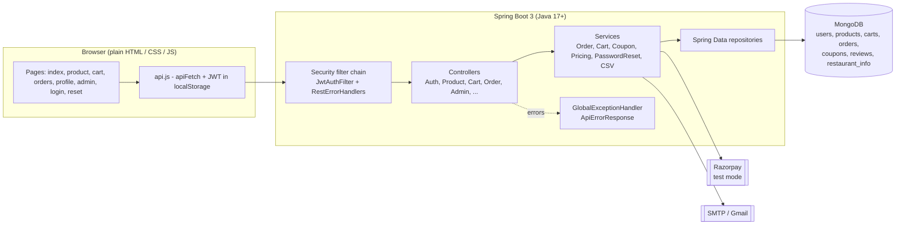
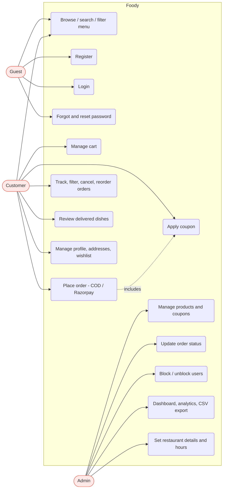
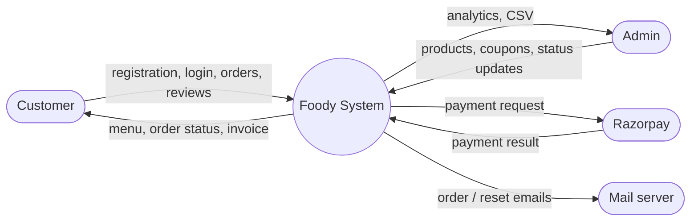
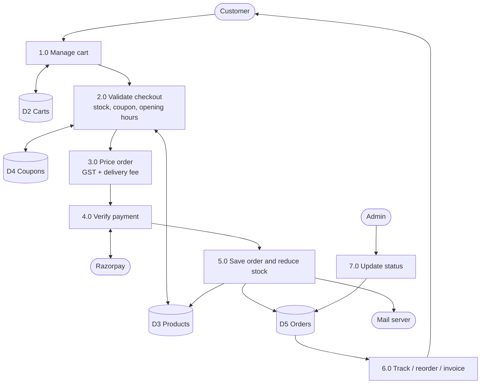
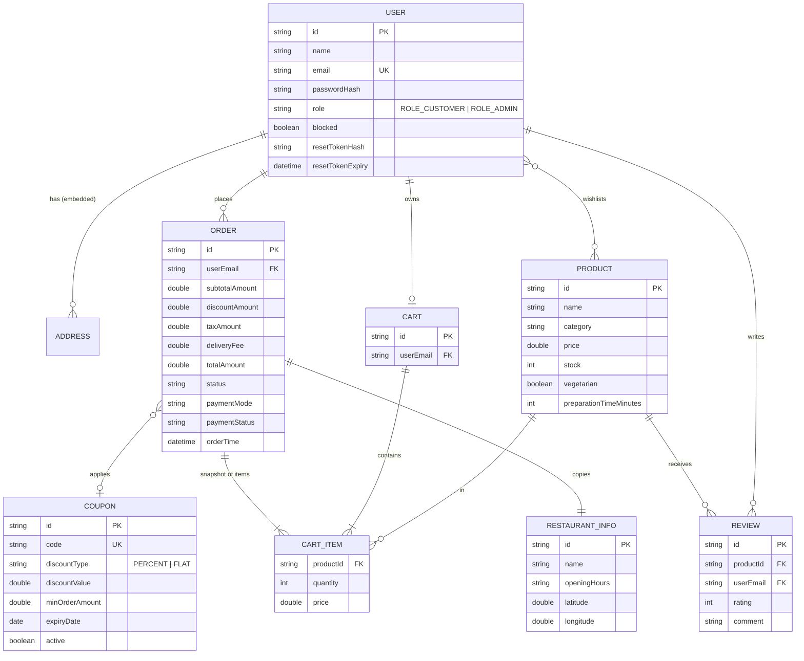
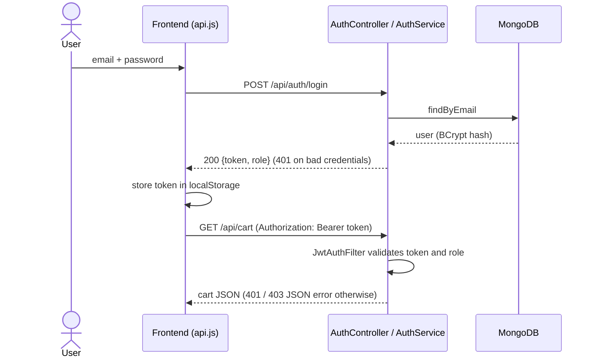
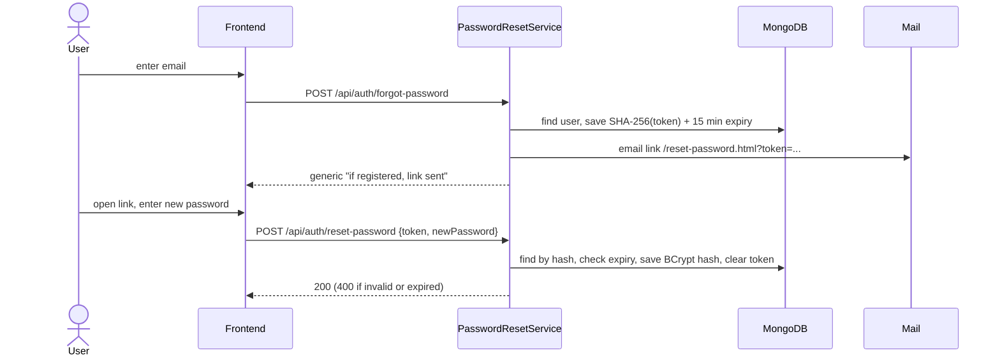
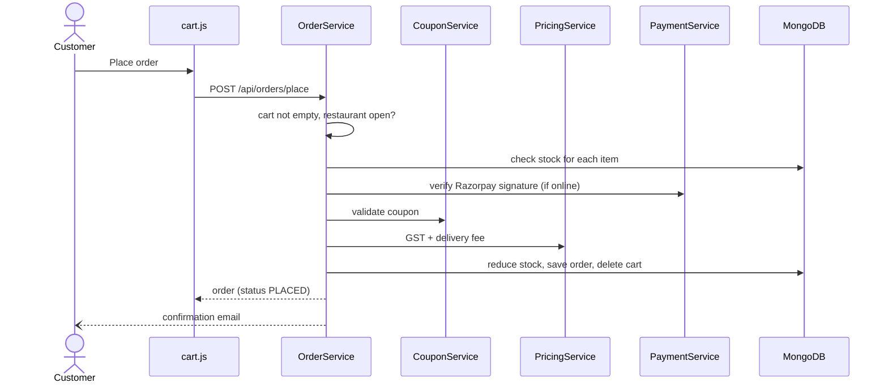
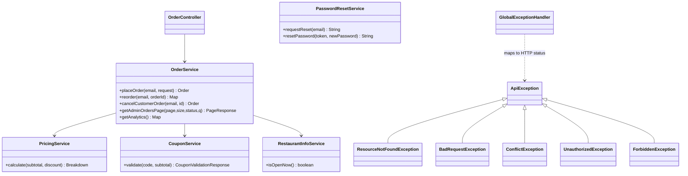

# Foody - Design Documents

All diagrams are [Mermaid](https://mermaid.js.org/) and render directly on GitHub and in VS Code (Markdown Preview Mermaid Support).

## 1. Architecture

## 2. Use case diagram

## 3. Data flow diagrams

### Level 0 (context)

### Level 1 (place an order)

## 4. Entity relationship diagram

## 5. Sequence diagrams

### Login and authenticated request

### Forgot / reset password

### Place order

## 6. Class diagram (core)

## 7. Demo flow (5 minutes)

1. **Start**: `cd backend && ./run-with-test-db.sh`, then `cd frontend && python3 -m http.server 5500`, open `http://localhost:5500`.
2. **Admin** (`admin@gmail.com` / `admin123`): Dashboard -> *Seed products* -> add a coupon `WELCOME10` -> look at the revenue charts.
3. **Customer**: Register -> Login -> browse, *Load more*, filter Veg, toggle dark mode.
4. Add dishes to cart -> see **GST + delivery fee** (free above Rs 499) -> apply `WELCOME10` -> add address -> place a COD order.
5. **Orders**: filter by status, *Reorder*, download invoice.
6. **Admin**: change the order status to Delivered -> *Orders CSV*.
7. **Customer**: leave a review on the delivered dish.
8. **Forgot password**: login page -> *Forgot password* -> copy the link printed in the backend console -> set a new password.
9. **API docs**: `http://localhost:8080/swagger-ui.html` -> Authorize with the login token.
